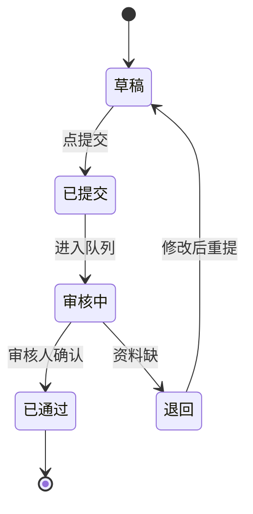
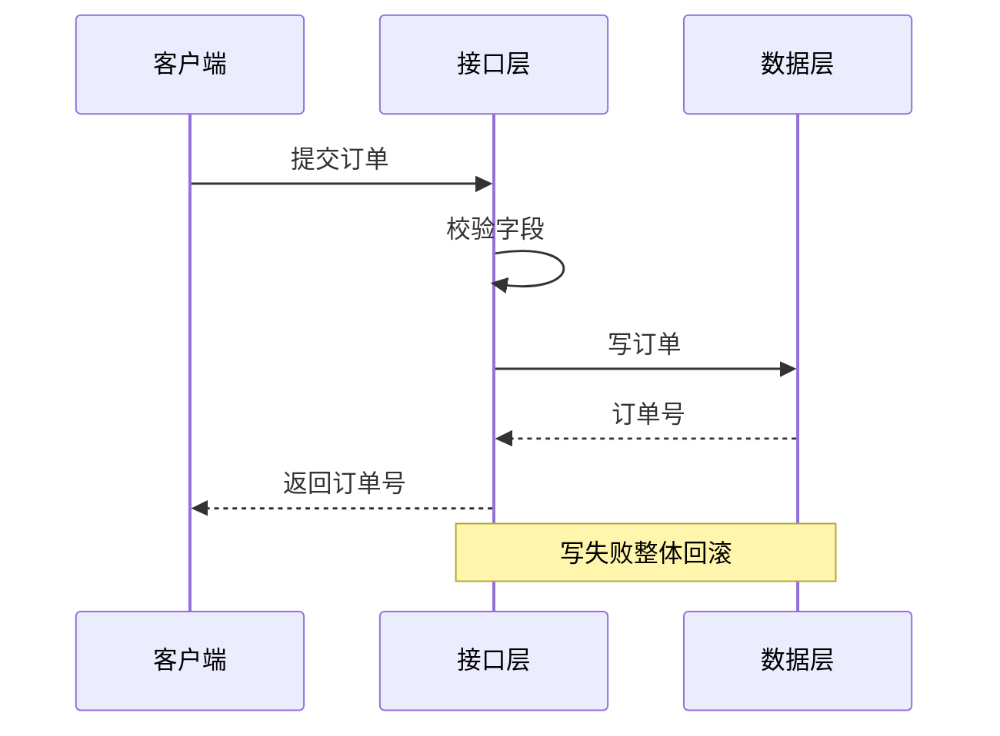
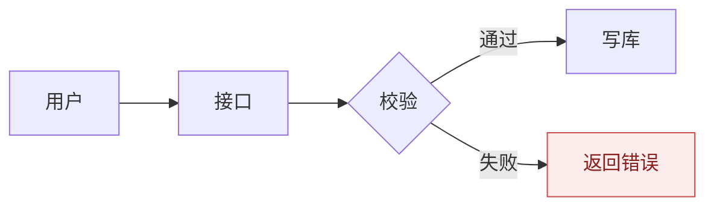

# 设计图

## 先选对图

图画错了，画得再漂亮也是错的。

| 你要说明的 | 用 |
| --- | --- |
| 一次请求经过谁、按什么顺序 | 时序图 |
| 一个东西有几种状态、怎么切换 | 状态图 |
| 数据表之间怎么连 | ER 图 |
| 东西部署在哪几台机器上 | 部署图 |
| 一段业务的判断与分支 | 流程图 |
| 模块之间的依赖方向 | 组件图 |

拿不准时问自己：这张图是讲**时间顺序**，还是讲**结构**？前者用时序，后者用别的。

## 写法约束

这些约束不是为了好看，是为了在 700px 宽的文档里还能读：

- **一图不超过 9 个参与者**。多了就拆成两张。
- **节点文字控制在 12 个字内**。超过就换行或改短，不要靠缩小字号。
- **箭头只朝一个主方向**。时序图从上往下，流程图从上往下或从左往右，不要来回折。
- **不写 ASCII 图**。改动一个字就要重排整块，维护成本高，渲染还不一致。

状态图示例：

时序图示例：

## 配色

只在需要区分「正常 / 异常 / 外部」时才上色，且不超过三种：

默认不上色。一张图里五颜六色，说明作者没想清楚哪里是重点。

## 渲染后要亲眼看

Mermaid 在网页和文档里的渲染不完全一致。写完必须：

1. 在实际文档里打开，确认宽度没溢出
2. 确认中文没有变成方框（字体问题）
3. 确认没有箭头穿过节点

本地没法渲染时，至少检查语法：未闭合的 `subgraph`、重复的节点 ID、在标签里用了 `→`、`:`、`()` 这类会被解析的字符。

## 常见错误

- **一张图讲完所有事**：改一个细节就要重画。按场景拆。
- **方框里写一整句话**：读者要在图里读段落，那不如写正文。
- **图和正文重复**：图要补充正文里说不清的关系，不是把正文抄一遍。
- **箭头没有标签**：两个节点之间为什么连着？写上去。