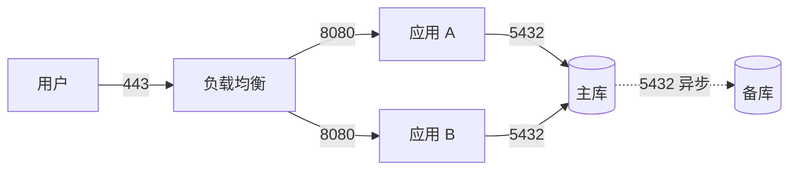

# 网络拓扑

## 先画边界

任何网络图第一件事是这条线：**哪里是外面，哪里是里面。**

- 公网能直接访问的
- 经过网关/负载均衡才能进的
- 只能内部访问的
- 完全不联网的（管理口、数据库、备份）

四个圈画出来，后面才有得画。很多时候一画就发现：数据库直接暴露在公网。

## 分段原则

按**敏感程度**分，不按部门分：

| 段 | 放什么 | 谁能访问 |
| --- | --- | --- |
| 公网入口 | 负载均衡、CDN | 所有人 |
| 应用段 | 业务服务 | 入口段 |
| 数据段 | 数据库、缓存 | 应用段 |
| 管理段 | 跳板机、监控 | 运维，只从固定地址 |
| 隔离段 | 对外调用、第三方接入 | 只出不进 |

同一个段里的机器互相能访问是默认的；跨段必须显式开。反过来说，如果整片都是一个网段，就等于没有分段。

## 拓扑图要标什么

一张能用的网络图，每条线都带两样：**方向和端口**。

再补三样标注：

1. **带宽或连接上限**：这条链路能扛多少
2. **是否跨地域**：跨地域就有延迟，延迟就有超时
3. **是否是单点**：只有一条路、一台机器，就是单点

## 排查连不上

按这个顺序查，能定位到具体一段：

1. 域名解析对不对：`nslookup` / `dig`
2. 能不能到目标：`ping`（不通不代表服务不通）
3. 端口通不通：`telnet` / `nc`
4. 服务在不在听：本机 `ss -lntp`
5. 防火墙放没放：本机规则 + 上游安全组
6. 服务本身：日志和健康检查

**每查一步就记录结果。**「都没问题」这种结论，没有价值。

## 常见坑

- **安全组放开了源地址 0.0.0.0**：等于没设。
- **代理只影响部分工具**：浏览器走了代理、命令行没走，两边结果不一致。排查时先确认走的哪条路。
- **容器里的 localhost**：容器里的 `127.0.0.1` 是容器自己，不是宿主机。
- **DNS 缓存**：改了记录但本机还是旧地址。先刷新缓存再测。

## 交付

一张图 + 一张表：

| 段 | 网段 | 用途 | 入口规则 |
| --- | --- | --- | --- |
| 应用 | 10.0.10.0/24 | 业务服务 | 只允许 LB 段 8080 |
| 数据 | 10.0.20.0/24 | 数据库 | 只允许应用段 5432 |

图给人看，表给配置用。只有图，配网关的时候还得猜。

## 常见错误

- **画了线没画端口**：等于没说这条路能不能通。
- **只说逻辑不说物理**：跨机房、跨云，故障时会很麻烦。
- **单点标不出来**：出问题才发现只有一台。
- **图和实际不一致**：半年没更新，比没有图更误导人。